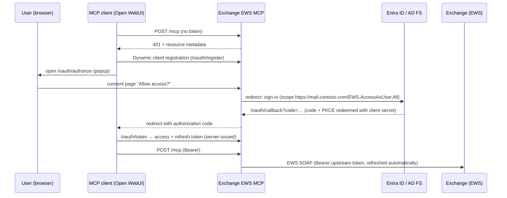

# Exchange EWS MCP

An [MCP](https://modelcontextprotocol.io) server for **on-premises Exchange Server (Subscription Edition, 2019)** that uses
**EWS with OAuth (Modern Authentication)**. It's written in C# / .NET 10 and runs as a Docker container behind your reverse proxy.

- **Streamable HTTP** transport, so MCP clients like [Open WebUI](https://docs.openwebui.com/features/extensibility/mcp/) connect to it directly, without mcpo.
- **Per-user OAuth**. Each user signs in with their own account in a browser popup, and the server calls EWS on their behalf.
  - **Microsoft Entra ID** with Hybrid Modern Authentication (HMA) is the primary target.
  - **AD FS** (Exchange on-premises Modern Authentication, Exchange 2019 CU13+ / SE) is supported through the same OIDC code path.
- **Draft-first by default.** Mail is saved as a draft and meetings are saved without sending invitations. Sending is opt-in.
- **Shared and delegated mailboxes** work through the optional `mailbox` parameter (the usual Exchange permissions apply).

## How authentication works



The server acts as a small **OAuth 2.1 authorization server** toward MCP clients. It implements RFC 8414 metadata,
RFC 7591 dynamic client registration, RFC 9728 protected resource metadata, and PKCE. Behind that, it brokers the sign-in to
Entra ID or AD FS. MCP clients get only the server's own tokens. The upstream Exchange tokens stay on the server,
encrypted with ASP.NET Core Data Protection and stored in SQLite, and are refreshed automatically.

Why the broker? Open WebUI's per-user "OAuth 2.1" mode needs dynamic client registration, which Entra ID doesn't offer.
The broker also keeps the Exchange token out of the MCP client.

## Tools

| Area | Tools |
| --- | --- |
| User | `whoami`, `resolve_names` |
| Mail | `list_folders`, `search_mail`, `read_mail`, `get_attachment`, `move_mail`, `mark_mail` |
| Drafts | `create_draft`, `create_reply_draft`, `create_forward_draft`, `update_draft`, `add_attachment_to_draft`, `delete_draft` |
| Calendar | `list_events`, `get_event`, `get_availability` (free/busy + suggested times), `create_event`, `update_event`, `delete_event`, `respond_to_meeting` |
| Automatic replies | `get_out_of_office`, `set_out_of_office` |
| Sending (only with `Exchange:AllowSend=true`) | `send_draft`, `send_meeting_invitations` |

With `AllowSend=false` (the default), the parameters that would send something are rejected: `sendInvitations`,
`sendUpdates`, `sendResponse`, and cancelling a meeting you organize.

Shared mailboxes: pass `mailbox: "team@contoso.com"` to `search_mail`, `list_folders`, `create_draft`, `list_events`,
`create_event`, the out-of-office tools and others. The signed-in user needs Full Access, plus Send As or Send on Behalf
to send from that mailbox.

## Setup with Microsoft Entra ID (Hybrid Modern Authentication)

Prerequisite: HMA is enabled for your on-premises Exchange, which means the EWS URLs (e.g. `https://mail.contoso.com`) are
registered as service principal names of the *Office 365 Exchange Online* enterprise application. If Outlook already
uses modern authentication against your on-premises Exchange, this is the case.

1. **Create an app registration** in Entra ID: *App registrations → New registration*.
   - Supported account types: *Single tenant*.
   - Redirect URI: platform **Web**, `https://mcp.contoso.com/oauth/callback` (your `Server:PublicBaseUrl` + `/oauth/callback`).
2. **Certificates & secrets**: create a client secret.
3. **API permissions**: *Add a permission → APIs my organization uses → Office 365 Exchange Online → Delegated →
   `EWS.AccessAsUser.All`*. Then click **Grant admin consent**. (`openid`, `profile`, `email` and `offline_access` from
   Microsoft Graph are added automatically.)
4. **Configure the server**:

   ```yaml
   Server__PublicBaseUrl: "https://mcp.contoso.com"
   IdentityProvider__Authority: "https://login.microsoftonline.com/<tenant-id>/v2.0"
   IdentityProvider__ClientId: "<application-client-id>"
   IdentityProvider__ClientSecret: "<client-secret>"
   IdentityProvider__Scopes__0: "openid"
   IdentityProvider__Scopes__1: "profile"
   IdentityProvider__Scopes__2: "email"
   IdentityProvider__Scopes__3: "offline_access"
   IdentityProvider__Scopes__4: "https://mail.contoso.com/EWS.AccessAsUser.All"
   Exchange__EwsUrl: "https://mail.contoso.com/EWS/Exchange.asmx"
   ```

   The host in the EWS scope must be the Exchange URL that is registered for HMA. It's the same value as the
   `https://<host>/EWS.AccessAsUser.All` scope used in desktop tools such as AutoSignature.NET.

## Setup with AD FS (Exchange Modern Authentication without hybrid)

> [!NOTE]
> The AD FS variant uses the same code path as Entra ID, but it hasn't been tested against a real AD FS yet.

Prerequisite: Modern Authentication with AD FS is configured as described in
[Enabling Modern Auth in Exchange on-premises](https://learn.microsoft.com/exchange/plan-and-deploy/post-installation-tasks/enable-modern-auth-in-exchange-server-on-premises).
That guide creates the application group `Outlook`, the Web API applications `https://mail.contoso.com/`, and the scope
`EWS.AccessAsUser.All`.

1. Add a **server application** (confidential client) to the existing `Outlook` application group, with the redirect URI
   `https://mcp.contoso.com/oauth/callback`, and generate a secret:

   ```powershell
   Add-AdfsServerApplication -Name "Exchange EWS MCP" -ApplicationGroupIdentifier "Outlook" `
     -Identifier "<new-guid>" -RedirectUri "https://mcp.contoso.com/oauth/callback" -GenerateClientSecret
   ```

2. Allow it to access the Exchange Web API:

   ```powershell
   Grant-AdfsApplicationPermission -ClientRoleIdentifier "<new-guid>" -ServerRoleIdentifier "https://mail.contoso.com/" `
     -ScopeNames "openid","profile","email","offline_access","EWS.AccessAsUser.All"
   ```

3. Configure the server:

   ```yaml
   IdentityProvider__Authority: "https://adfs.contoso.com/adfs"
   IdentityProvider__ClientId: "<new-guid>"
   IdentityProvider__ClientSecret: "<generated-secret>"
   IdentityProvider__Resource: "https://mail.contoso.com/"
   IdentityProvider__Scopes__0: "openid"
   IdentityProvider__Scopes__1: "profile"
   IdentityProvider__Scopes__2: "offline_access"
   IdentityProvider__Scopes__3: "EWS.AccessAsUser.All"
   ```

   AD FS issues refresh tokens for confidential clients only with *Keep Me Signed In* or device registration (see the
   linked guide). Without them, users have to sign in again when the access token expires.

## Running with Docker

```bash
docker compose up -d
```

[`docker-compose.yml`](docker-compose.yml) contains a complete example. Some notes:

- Run the server behind a TLS-terminating reverse proxy. `Server:PublicBaseUrl` must be the public `https://` origin
  without a path, because all OAuth URLs are derived from it.
- `/data` holds the SQLite database and the Data Protection key ring. Keep it on a persistent volume and treat it as
  sensitive, since it contains the encrypted refresh tokens. If you lose the keys, all users have to sign in again.
- If Exchange or AD FS uses an internal CA, mount the CA certificate (PEM) and set `SSL_CERT_DIR=/etc/ssl/certs:/certs`.
  .NET on Linux then trusts it for all outgoing connections.
- Health endpoint: `GET /healthz`.

## Connecting Open WebUI

1. In Open WebUI, go to **Admin Settings → External Tools / Integrations → Add connection**.
2. Set **Type** to `MCP (Streamable HTTP)` and **URL** to `https://mcp.contoso.com/mcp`.
3. Set **Auth** to `OAuth 2.1` and click **Register Client**. Open WebUI uses dynamic client registration.
4. Each user enables the tool in a chat (**+ → Integrations → Tools**). The first time, a popup opens with the consent
   page and then the Microsoft (or AD FS) sign-in.

Recommendations:

- Set `OAuth__AllowedRedirectUriPrefixes__0` to your Open WebUI URL (e.g. `https://openwebui.contoso.com/`).
  Only Open WebUI can then register clients, and the extra consent page is skipped.
- Open WebUI needs a fixed `WEBUI_SECRET_KEY`, otherwise OAuth tokens break when it restarts.
- Don't set OAuth tools as default tools on a model, because the sign-in redirect can't happen in the middle of a request.

To use Open WebUI's `OAuth 2.1 (Static)` mode instead, pre-register the client in `OAuth:StaticClients`
(client id, secret and Open WebUI's redirect URI). Static clients skip the consent page.

## Configuration reference

All settings can be set in `appsettings.json` or as environment variables (`Section__Key`, arrays as `Key__0`, `Key__1`).

| Setting | Default | Description |
| --- | --- | --- |
| `Server:PublicBaseUrl` | – | Public origin, e.g. `https://mcp.contoso.com` (required) |
| `Server:DataDirectory` | `data` (`/data` in Docker) | SQLite database and key ring |
| `Server:McpPath` | `/mcp` | Path of the MCP endpoint |
| `IdentityProvider:Authority` | – | Entra ID: `https://login.microsoftonline.com/<tenant>/v2.0`, AD FS: `https://adfs.contoso.com/adfs` |
| `IdentityProvider:ClientId` / `ClientSecret` | – | Upstream confidential client |
| `IdentityProvider:Scopes` | – | Must include the EWS scope and `offline_access` |
| `IdentityProvider:Resource` | – | Optional `resource` parameter (AD FS) |
| `OAuth:AccessTokenLifetime` | `01:00:00` | Lifetime of the server-issued access tokens |
| `OAuth:RefreshTokenLifetime` | `30.00:00:00` | Lifetime of the server-issued refresh tokens (rotated on use) |
| `OAuth:AllowDynamicClientRegistration` | `true` | RFC 7591 registration endpoint |
| `OAuth:AllowedRedirectUriPrefixes` | `[]` | Allowed redirect URI prefixes for registered clients; these skip the consent page. If empty, any https or loopback URI may register and users must confirm a consent page |
| `OAuth:StaticClients` | `[]` | Pre-registered clients (`ClientId`, `ClientSecret`, `RedirectUris`, `Name`) |
| `Exchange:EwsUrl` | – | e.g. `https://mail.contoso.com/EWS/Exchange.asmx` (required) |
| `Exchange:TimeZone` | `Europe/Berlin` | IANA or Windows time zone for interpreting and rendering dates |
| `Exchange:AllowSend` | `false` | Enables the sending tools and parameters |
| `Exchange:MaxResults` | `50` | Upper bound for list/search results |
| `Exchange:MaxBodyLength` | `20000` | Characters of a message body returned to the model |
| `Exchange:MaxAttachmentBytes` | `5242880` | Largest attachment that is downloaded or added |
| `Exchange:TraceEws` | `false` | Logs EWS SOAP traffic at debug level (contains mail content) |

## Development

```bash
dotnet build
dotnet test
```

The tests cover the complete OAuth flow against a simulated identity provider, and tool calls against a simulated EWS
endpoint.

Built on:
- [ModelContextProtocol C# SDK](https://github.com/modelcontextprotocol/csharp-sdk)
- [Exchange.WebServices.NETCore](https://github.com/ItsClemi/ews-managed-api)

The feature set was inspired by [ShermanGu/exchange-ews-mcp](https://github.com/ShermanGu/exchange-ews-mcp).

## License

MIT
