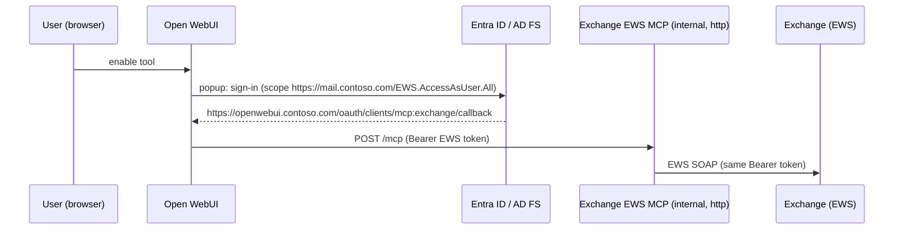

# Exchange EWS MCP

An [MCP](https://modelcontextprotocol.io) server for **on-premises Exchange Server (Subscription Edition, 2019)** that uses
**EWS with OAuth (Modern Authentication)**. It's written in C# / .NET 10 and runs as a Docker container.

> [!WARNING]
> **Work in progress.** This project has so far only been tested against simulated identity providers and EWS endpoints,
> not against a real Exchange Server, Entra ID, AD FS or Open WebUI. Configuration and tools may still change.
> Start with `Exchange:AccessLevel=ReadOnly` when you try it.

- **Streamable HTTP** transport, so MCP clients like [Open WebUI](https://docs.openwebui.com/features/extensibility/mcp/) connect to it directly, without mcpo.
- **Per-user OAuth**. Each user signs in with their own account in a browser popup, and the server calls EWS on their behalf.
  Two modes: **Passthrough**, where the MCP client signs in and the server stays internal, and **Broker**, where the server is the OAuth server.
  - **Microsoft Entra ID** with Hybrid Modern Authentication (HMA) is the primary target.
  - **AD FS** (Exchange on-premises Modern Authentication, Exchange 2019 CU13+ / SE) is supported through the same OIDC code path.
- **Draft-first by default.** Mail is saved as a draft and meetings are saved without sending invitations. Sending is opt-in.
- **Guard rails:** with `Exchange:AccessLevel`, the server can be read-only, or allow creating and editing but no deleting.
- **Shared and delegated mailboxes** work through the optional `mailbox` parameter (the usual Exchange permissions apply).

## Authentication modes

### Passthrough (recommended for Open WebUI)



Open WebUI is the OAuth client. The redirect URI points to Open WebUI, which already has a certificate. Open WebUI keeps
and refreshes the tokens. The MCP server only has to be reachable *from Open WebUI*, e.g. as `http://exchange-ews-mcp:8080`
in the same Docker network. It needs no certificate, no public DNS name and no client secret.

The server passes the token to Exchange unchanged. Exchange validates it, and the server only reads its expiry and the user
name. Because of this, the MCP endpoint must not be reachable by other clients.

### Broker

The server acts as a small **OAuth 2.1 authorization server** toward MCP clients. It implements RFC 8414 metadata,
RFC 7591 dynamic client registration, RFC 9728 protected resource metadata, and PKCE. Behind that, it brokers the sign-in
to Entra ID or AD FS. MCP clients get only the server's own tokens. The Exchange tokens stay on the server, encrypted
with ASP.NET Core Data Protection and stored in SQLite, and are refreshed automatically.

This mode works with any MCP client that supports dynamic client registration. The users' browsers must be able to reach
the server over HTTPS, because Entra redirects them to `https://<mcp-host>/oauth/callback`.

## Tools

| Area | Tools |
| --- | --- |
| User | `whoami`, `resolve_names` |
| Mail | `list_folders`, `search_mail`, `read_mail`, `get_attachment`, `move_mail`, `mark_mail` |
| Drafts | `create_draft`, `create_reply_draft`, `create_forward_draft`, `update_draft`, `add_attachment_to_draft`, `delete_draft` |
| Calendar | `list_events`, `get_event`, `get_availability` (free/busy + suggested times), `create_event`, `update_event`, `delete_event`, `respond_to_meeting` |
| Automatic replies | `get_out_of_office`, `set_out_of_office` |
| Sending (only with `Exchange:AllowSend=true`) | `send_draft`, `send_meeting_invitations` |

With `AllowSend=false` (the default), the parameters that would send something are rejected: `sendInvitations`,
`sendUpdates`, `sendResponse`, and cancelling a meeting you organize.

### Guard rails

`Exchange:AccessLevel` limits which tools the server offers. Tools that aren't allowed are not listed and can't be called.

| `AccessLevel` | Allowed |
| --- | --- |
| `ReadOnly` | Reading only: `whoami`, `resolve_names`, `list_folders`, `search_mail`, `read_mail`, `get_attachment`, `list_events`, `get_event`, `get_availability`, `get_out_of_office` |
| `NoDelete` | Everything except deleting: no `delete_draft` or `delete_event`, `move_mail` refuses Deleted Items, and `respond_to_meeting` can't decline (Exchange moves declined meetings to Deleted Items) |
| `Full` (default) | All tools |

The filter uses the MCP annotations of the tools (`readOnlyHint`, `destructiveHint`). Sending is controlled separately
by `AllowSend`, and it is never possible with `ReadOnly`.

Shared mailboxes: pass `mailbox: "team@contoso.com"` to the tools, both when listing (`search_mail`, `list_folders`,
`list_events`, ...) and when working with an item from that mailbox (`read_mail`, `get_attachment`, `update_draft`, ...).
The server then sends `X-AnchorMailbox`, so Exchange routes the request to the server hosting that mailbox. The
signed-in user needs Full Access, plus Send As or Send on Behalf to send from that mailbox.

## Setup with Microsoft Entra ID (Hybrid Modern Authentication)

Prerequisite: HMA is enabled for your on-premises Exchange, which means the EWS URLs (e.g. `https://mail.contoso.com`) are
registered as service principal names of the *Office 365 Exchange Online* enterprise application. If Outlook already
uses modern authentication against your on-premises Exchange, this is the case.

1. **Create an app registration** in Entra ID: *App registrations → New registration*.
   - Supported account types: *Single tenant*.
   - Redirect URI: platform **Web**, either
     - Passthrough: `https://openwebui.contoso.com/oauth/clients/mcp:<connection-id>/callback`, where `<connection-id>`
       is the *ID* of the tool connection in Open WebUI (e.g. `exchange`), or
     - Broker: `https://mcp.contoso.com/oauth/callback` (your `Server:PublicBaseUrl` + `/oauth/callback`).
2. **Certificates & secrets**: create a client secret.
3. **API permissions**: *Add a permission → APIs my organization uses → Office 365 Exchange Online → Delegated →
   `EWS.AccessAsUser.All`*. Then click **Grant admin consent**. (`openid`, `profile`, `email` and `offline_access` from
   Microsoft Graph are added automatically.)
4. **Configure the server** (Broker mode; for Passthrough, see [Connecting Open WebUI](#connecting-open-webui)):

   ```yaml
   Server__PublicBaseUrl: "https://mcp.contoso.com"
   IdentityProvider__Authority: "https://login.microsoftonline.com/<tenant-id>/v2.0"
   IdentityProvider__ClientId: "<application-client-id>"
   IdentityProvider__ClientSecret: "<client-secret>"
   IdentityProvider__Scopes__0: "openid"
   IdentityProvider__Scopes__1: "profile"
   IdentityProvider__Scopes__2: "email"
   IdentityProvider__Scopes__3: "offline_access"
   IdentityProvider__Scopes__4: "https://mail.contoso.com/EWS.AccessAsUser.All"
   Exchange__EwsUrl: "https://mail.contoso.com/EWS/Exchange.asmx"
   ```

   The host in the EWS scope must be the Exchange URL that is registered for HMA. It's the same value as the
   `https://<host>/EWS.AccessAsUser.All` scope used in desktop tools such as AutoSignature.NET. Use the same host in
   `Exchange:EwsUrl`. To list the registered URLs:

   ```powershell
   Connect-MgGraph -Scopes Application.Read.All
   (Get-MgServicePrincipal -Filter "appId eq '00000002-0000-0ff1-ce00-000000000000'").ServicePrincipalNames
   ```

## Setup with AD FS (Exchange Modern Authentication without hybrid)

> [!NOTE]
> The AD FS variant uses the same code path as Entra ID, but it hasn't been tested against a real AD FS yet.

Prerequisite: Modern Authentication with AD FS is configured as described in
[Enabling Modern Auth in Exchange on-premises](https://learn.microsoft.com/exchange/plan-and-deploy/post-installation-tasks/enable-modern-auth-in-exchange-server-on-premises).
That guide creates the application group `Outlook`, the Web API applications `https://mail.contoso.com/`, and the scope
`EWS.AccessAsUser.All`.

1. Add a **server application** (confidential client) to the existing `Outlook` application group, with the redirect URI
   `https://mcp.contoso.com/oauth/callback`, and generate a secret:

   ```powershell
   Add-AdfsServerApplication -Name "Exchange EWS MCP" -ApplicationGroupIdentifier "Outlook" `
     -Identifier "<new-guid>" -RedirectUri "https://mcp.contoso.com/oauth/callback" -GenerateClientSecret
   ```

2. Allow it to access the Exchange Web API:

   ```powershell
   Grant-AdfsApplicationPermission -ClientRoleIdentifier "<new-guid>" -ServerRoleIdentifier "https://mail.contoso.com/" `
     -ScopeNames "openid","profile","email","offline_access","EWS.AccessAsUser.All"
   ```

3. Configure the server:

   ```yaml
   IdentityProvider__Authority: "https://adfs.contoso.com/adfs"
   IdentityProvider__ClientId: "<new-guid>"
   IdentityProvider__ClientSecret: "<generated-secret>"
   IdentityProvider__Resource: "https://mail.contoso.com/"
   IdentityProvider__Scopes__0: "openid"
   IdentityProvider__Scopes__1: "profile"
   IdentityProvider__Scopes__2: "offline_access"
   IdentityProvider__Scopes__3: "EWS.AccessAsUser.All"
   ```

   AD FS issues refresh tokens for confidential clients only with *Keep Me Signed In* or device registration (see the
   linked guide). Without them, users have to sign in again when the access token expires.

## Running with Docker

```bash
docker compose up -d
```

[`docker-compose.yml`](docker-compose.yml) contains a complete example. Some notes:

- `Server:PublicBaseUrl` is the origin under which clients reach the server, without a path. In Broker mode it must be the
  public `https://` URL behind your reverse proxy. In Passthrough mode the internal URL is enough, e.g. `http://exchange-ews-mcp:8080`.
- `/data` holds the SQLite database and the Data Protection key ring. In Broker mode, keep it on a persistent volume and
  treat it as sensitive, since it contains the encrypted refresh tokens. If you lose the keys, all users have to sign in again.
- If Exchange or AD FS uses an internal CA, mount the CA certificate (PEM) and set `SSL_CERT_DIR=/etc/ssl/certs:/certs`.
  .NET on Linux then trusts it for all outgoing connections.
- Health endpoint: `GET /healthz`.

## Connecting Open WebUI

### Passthrough (no certificate for the MCP server)

1. Run the MCP server in the same Docker network as Open WebUI and don't publish its port:

   ```yaml
   Server__PublicBaseUrl: "http://exchange-ews-mcp:8080"
   OAuth__Mode: "Passthrough"
   IdentityProvider__Authority: "https://login.microsoftonline.com/<tenant-id>/v2.0"
   IdentityProvider__Scopes__0: "openid"
   IdentityProvider__Scopes__1: "profile"
   IdentityProvider__Scopes__2: "offline_access"
   IdentityProvider__Scopes__3: "https://mail.contoso.com/EWS.AccessAsUser.All"
   Exchange__EwsUrl: "https://mail.contoso.com/EWS/Exchange.asmx"
   ```

   `IdentityProvider:ClientId` and `ClientSecret` aren't needed, because Open WebUI holds them. The server publishes the
   authority and scopes in its protected resource metadata, and Open WebUI picks them up from there.
2. In Open WebUI, go to **Admin Settings → External Tools / Integrations → Add connection**:
   - **Type**: `MCP (Streamable HTTP)`
   - **URL**: `http://exchange-ews-mcp:8080/mcp`
   - **ID**: e.g. `exchange`. It's part of the redirect URI, so don't change it later.
   - **Auth**: `OAuth 2.1 (Static)` with the **Client ID** and **Client Secret** of the Entra app registration. Leave
     *OAuth Server URL* and *Scopes* empty.
   - Click **Register Client**, then save. Open WebUI reads the scopes from the MCP server only at this moment, so
     click **Register Client** and save again whenever you change `IdentityProvider:Scopes`.
3. In the Entra app registration, the redirect URI must be `https://openwebui.contoso.com/oauth/clients/mcp:exchange/callback`
   (Open WebUI's `WEBUI_URL` + `/oauth/clients/mcp:<ID>/callback`).
4. Each user enables the tool in a chat (**+ → Integrations → Tools**). The first time, a Microsoft sign-in popup opens.

### Broker

1. Set **Type** to `MCP (Streamable HTTP)`, **URL** to `https://mcp.contoso.com/mcp` and **Auth** to `OAuth 2.1`, then
   click **Register Client**. Open WebUI uses dynamic client registration.
2. Set `OAuth__AllowedRedirectUriPrefixes__0` to your Open WebUI URL (e.g. `https://openwebui.contoso.com/`). Only Open
   WebUI can then register clients, and the extra consent page is skipped.

### For both modes

- Open WebUI needs a fixed `WEBUI_SECRET_KEY`, otherwise OAuth tokens break when it restarts.
- Don't set OAuth tools as default tools on a model, because the sign-in redirect can't happen in the middle of a request.

## Troubleshooting

| Error | Cause |
| --- | --- |
| `AADSTS500011: The resource principal named https://… was not found` | The host in the EWS scope isn't registered for HMA. Use one of the URLs from the `ServicePrincipalNames` list above (often a dedicated EWS host). |
| `AADSTS9010010: The resource parameter provided in the request doesn't match with the requested scopes` | The EWS scope isn't a full URL (e.g. only `EWS.AccessAsUser.All`). Open WebUI then also sends a `resource` parameter, which Entra rejects. Always use `https://<host>/EWS.AccessAsUser.All`, then click **Register Client** in Open WebUI again and save. |
| Tool error mentioning HTTP 401 | Exchange rejected the token: the scope host and `Exchange:EwsUrl` don't belong to the same HMA-registered Exchange, or EWS doesn't allow OAuth. |

## Configuration reference

All settings can be set in `appsettings.json` or as environment variables (`Section__Key`, arrays as `Key__0`, `Key__1`).

| Setting | Default | Description |
| --- | --- | --- |
| `Server:PublicBaseUrl` | – | Origin under which clients reach the server, e.g. `https://mcp.contoso.com` or `http://exchange-ews-mcp:8080` (required) |
| `Server:DataDirectory` | `data` (`/data` in Docker) | SQLite database and key ring |
| `IdentityProvider:Authority` | – | Entra ID: `https://login.microsoftonline.com/<tenant>/v2.0`, AD FS: `https://adfs.contoso.com/adfs` |
| `IdentityProvider:ClientId` / `ClientSecret` | – | Upstream confidential client (Broker mode only) |
| `IdentityProvider:Scopes` | – | Must include the EWS scope and `offline_access` |
| `IdentityProvider:Resource` | – | Optional `resource` parameter (AD FS) |
| `OAuth:Mode` | `Broker` | `Broker` or `Passthrough` |
| `OAuth:AccessTokenLifetime` | `01:00:00` | Lifetime of the server-issued access tokens |
| `OAuth:RefreshTokenLifetime` | `30.00:00:00` | Lifetime of the server-issued refresh tokens (rotated on use) |
| `OAuth:AllowedRedirectUriPrefixes` | `[]` | Allowed redirect URI prefixes for registered clients; these skip the consent page. If empty, any https or loopback URI may register and users must confirm a consent page |
| `Exchange:EwsUrl` | – | e.g. `https://mail.contoso.com/EWS/Exchange.asmx` (required) |
| `Exchange:TimeZone` | `Europe/Berlin` | IANA or Windows time zone for interpreting and rendering dates |
| `Exchange:AllowSend` | `false` | Enables the sending tools and parameters |
| `Exchange:AccessLevel` | `Full` | `ReadOnly`, `NoDelete` or `Full` (see [Guard rails](#guard-rails)) |
| `Exchange:MaxResults` | `50` | Upper bound for list/search results |
| `Exchange:MaxBodyLength` | `20000` | Characters of a message body returned to the model |
| `Exchange:MaxAttachmentBytes` | `5242880` | Largest attachment that is downloaded or added |
| `Exchange:TraceEws` | `false` | Logs EWS SOAP traffic at debug level (contains mail content) |

## Development

```bash
dotnet build
dotnet test
```

The tests cover the complete OAuth flow against a simulated identity provider, and tool calls against a simulated EWS
endpoint.

Built on:
- [ModelContextProtocol C# SDK](https://github.com/modelcontextprotocol/csharp-sdk)
- [Exchange.WebServices.NETCore](https://github.com/ItsClemi/ews-managed-api)

The feature set was inspired by [ShermanGu/exchange-ews-mcp](https://github.com/ShermanGu/exchange-ews-mcp).

## License

MIT
